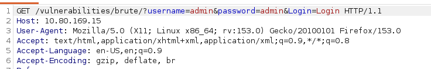
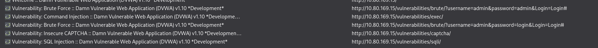
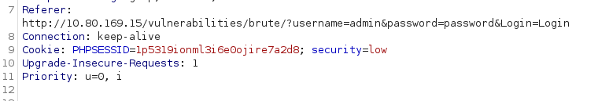

# [VULN-02] Authentication Credentials Exposed Through HTTP GET Query Parameters

- **Severity:** Low
- **CWE:** [CWE-598 – Use of GET Request Method With Sensitive Query Strings](https://cwe.mitre.org/data/definitions/598.html)
- **Affected endpoint:** `/vulnerabilities/brute/`
- **Affected security levels:** Low, Medium and High
- **Remediation status:** Addressed in Impossible
- **Affected parameters:** `username`, `password` (GET)

## Summary

The DVWA authentication mechanism accepts and transmits user credentials through HTTP `GET` query parameters across the Low, Medium and High security levels. When an authentication request is submitted, both the username and plaintext password are appended directly to the request URL.

Because URL query strings can be retained in browser history and exposed through HTTP Referer headers, transmitting credentials through GET requests introduces additional exposure points beyond the intended authentication flow. This could allow sensitive authentication information to be disclosed to third parties or individuals with access to the affected browser or intermediary infrastructure.

During testing, credentials were successfully observed in the HTTP Referer header, demonstrating that sensitive authentication information could be propagated beyond the original authentication request.

The Impossible security level addresses this issue by requiring credentials to be submitted within the body of an HTTP `POST` request.

## Business Impact

If implemented in a production environment, transmitting authentication credentials through URL query parameters could expose usernames and plaintext passwords through browser history, Referer headers and infrastructure that processes or records request URLs.

An attacker who gains access to these exposure points could potentially retrieve valid authentication credentials without directly exploiting the authentication mechanism. For example, credentials disclosed through Referer headers could become accessible to third-party resources or services receiving the referring URL, depending on the application's resource-loading behaviour and Referrer-Policy configuration.

Successful retrieval of these credentials could enable unauthorised account access. The impact may be greater where administrative accounts are affected or where users reuse passwords across multiple services.

However, exploitation generally depends on an additional exposure condition, such as access to browser history, visibility of Referer headers or access to infrastructure handling the affected requests.

## Transport Method Comparison Across Security Levels

The HTTP request method used to process login submissions was evaluated across all four DVWA security levels.

| Security control | Low | Medium | High | Impossible |
|---|---|---|---|---|
| HTTP method | GET | GET | GET | POST |
| Credential location | URL query string | URL query string | URL query string | Request body |
| Credentials exposed in URL | Yes | Yes | Yes | No |
| Potential exposure through browser history | Yes | Yes | Yes | No |
| Potential exposure through Referer headers | Yes | Yes | Yes | Not through the request URL |

Across the Low, Medium and High implementations, the backend scripts retrieve authentication credentials directly from the PHP `$_GET` superglobal array. Only the Impossible implementation uses `$_POST` to process the credentials, keeping sensitive parameters out of the request URL.

The comparison demonstrates that additional security controls introduced at the Medium and High levels do not address the underlying exposure of authentication credentials through URL query parameters.

## Proof of Concept

**Testing environment:** DVWA Security Level – High

1. Configure DVWA to use the High security level (`security=high`).
2. Navigate to `/vulnerabilities/brute/`, enter valid or test credentials into the login form, and intercept the request using Burp Suite Proxy.
3. Observe that the browser issues an HTTP `GET` request containing the `username` and `password` parameters in the request URI.

**Example HTTP request:**

```http
GET /vulnerabilities/brute/?username=admin&password=password&user_token=<token>&Login=Login HTTP/1.1
Host: <target-ip>
Cookie: PHPSESSID=<session-id>; security=high
```

4. Inspect the browser address bar and history to confirm that the submitted credentials are retained in the URL.
5. Inspect the HTTP Referer header in subsequent requests to identify whether the original URL, including the authentication parameters, is disclosed.

**Result:** The submitted username and plaintext password were visible in the request URI and browser address bar. The credentials were also successfully observed in the HTTP Referer header, demonstrating that sensitive authentication information could be propagated through subsequent HTTP requests.

### Evidence



*Figure 1: Intercepted HTTP GET request showing plaintext credentials in the URL query string.*



*Figure 2: Plaintext credentials visible in the browser address bar after authentication.*




*Figure 3: Subsequent HTTP request containing the original authentication URL in its Referer header, exposing the submitted credentials.*

## Root Cause Analysis

The vulnerability stems from the authentication form and server-side handler using the HTTP `GET` method to process sensitive login parameters.

In `vulnerabilities/brute/source/high.php` (as well as `low.php` and `medium.php`), the server retrieves authentication inputs directly from the `$_GET` array:

```php
if( isset( $_GET[ 'Login' ] ) ) {
    // Check Anti-CSRF token
    checkToken( $_REQUEST[ 'user_token' ], $_SESSION[ 'session_token' ], 'index.php' );

    // Sanitise username input
    $user = $_GET[ 'username' ];
    ...
    // Sanitise password input
    $pass = $_GET[ 'password' ];
```

HTTP GET requests append submitted form parameters to the request URI. Since URLs are commonly retained in browser history and may be included in HTTP Referer headers, using GET to transmit authentication credentials creates unnecessary exposure of sensitive information.

In contrast, `vulnerabilities/brute/source/impossible.php` restricts authentication processing to `$_POST` parameters:

```php
if( isset( $_POST[ 'Login' ] ) &&
    isset( $_POST['username'] ) &&
    isset( $_POST['password'] ) )
```

This ensures that credentials are transmitted within the HTTP request body rather than the URI.

## Remediation

Authentication endpoints should exclusively use HTTP `POST` requests to transmit credentials within the request body. The application should reject authentication parameters supplied through GET query strings to prevent accidental credential exposure through URLs. All authentication traffic must also be protected using HTTPS to ensure credentials remain encrypted during transmission.

Additionally, applications should implement an appropriate `Referrer-Policy`, such as `no-referrer`, to prevent sensitive URL information from being disclosed through Referer headers. Authentication pages should also return appropriate cache-control headers, including `Cache-Control: no-store`, to reduce the risk of sensitive information being retained by browsers or intermediary caches.

Where possible, applications should avoid including sensitive information in URLs altogether and ensure that logging configurations do not unnecessarily capture authentication-related data.

## References

- [CWE-598: Use of GET Request Method With Sensitive Query Strings](https://cwe.mitre.org/data/definitions/598.html)
- [OWASP Web Security Testing Guide – Testing for Sensitive Information Sent via Unencrypted Channels](https://owasp.org/www-project-web-security-testing-guide/)
- [OWASP Authentication Cheat Sheet](https://cheatsheetseries.owasp.org/cheatsheets/Authentication_Cheat_Sheet.html)
- [MDN – HTTP Referer Header](https://developer.mozilla.org/en-US/docs/Web/HTTP/Reference/Headers/Referer)
- [MDN – Referrer-Policy](https://developer.mozilla.org/en-US/docs/Web/HTTP/Reference/Headers/Referrer-Policy)
