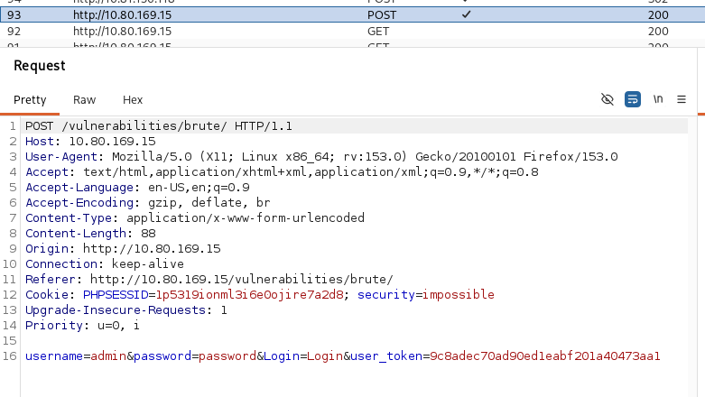

# [VULN-04] Cleartext Transmission of Sensitive Information Over HTTP

- **Severity:** Low
- **CWE:** [CWE-319 – Cleartext Transmission of Sensitive Information](https://cwe.mitre.org/data/definitions/319.html)
- **Affected endpoint:** `/vulnerabilities/brute/` (and application-wide session transport)
- **Affected security levels:** Low, Medium, High and Impossible
- **Remediation status:** Unaddressed (transport-layer configuration)
- **Affected parameters:** `username`, `password`, `PHPSESSID` session cookie

## Summary

Network traffic inspection revealed that the DVWA web application serves its authentication endpoint over unencrypted HTTP rather than enforcing HTTPS (TLS). This affects all four security configurations, including the `Impossible` level, which submits credentials using HTTP POST requests.

Because TLS is not used, authentication credentials and session identifiers are transmitted without transport-layer encryption. Consequently, usernames, plaintext passwords and authenticated session cookies (`PHPSESSID`) can be intercepted by an attacker capable of monitoring network traffic between the client and server.

Additionally, inspection of the `Set-Cookie` response header confirmed that the `PHPSESSID` cookie is issued without the `Secure` attribute, allowing browsers to transmit the session cookie over unencrypted HTTP connections.

Although the absence of transport encryption exposes sensitive information, exploitation requires an attacker to obtain a suitable position on the network path or otherwise gain access to the transmitted traffic.

## Business Impact

If deployed in a production environment, transmitting authentication credentials and session identifiers over unencrypted HTTP could expose users to network-based interception attacks. An attacker positioned on a shared local network, public Wi-Fi access point, compromised router or other network infrastructure could capture plaintext authentication credentials and session identifiers. Captured credentials could subsequently be used to authenticate as legitimate users, while intercepted session cookies could potentially allow an attacker to impersonate an already authenticated user.

The likelihood of exploitation depends on the attacker's ability to monitor or manipulate network traffic between the client and server. Consequently, although successful exploitation could result in account compromise, an attacker would generally require an appropriate network position or another means of accessing the unencrypted traffic.

## Transport Encryption Comparison Across Security Levels

Network transport behaviour was observed across all four DVWA security levels during proxy and packet inspection.

| Security control | Low | Medium | High | Impossible |
|---|---|---|---|---|
| Transport protocol | HTTP (cleartext) | HTTP (cleartext) | HTTP (cleartext) | HTTP (cleartext) |
| Credentials encrypted in transit | No | No | No | No |
| Session cookie (`PHPSESSID`) encrypted in transit | No | No | No | No |
| Cookie `Secure` attribute enforced | No | No | No | No |

While switching from `GET` to `POST` in the `Impossible` security level removes credentials from the URL query string, the `POST` request body and `Cookie` headers remain completely readable in cleartext on the wire when transmitted over HTTP.

## Proof of Concept

**Testing environment:** DVWA Security Level – Impossible (and Low–High)

1. Configure DVWA to use the `Impossible` security level (`security=impossible`) and access `/vulnerabilities/brute/` over `http://`.
2. Submit a login request containing test credentials while capturing network traffic in Burp Suite Proxy.
3. Inspect the raw HTTP request transmitted over the network interface:

```http
POST /vulnerabilities/brute/ HTTP/1.1
Host: <target-ip>
Cookie: PHPSESSID=<session-id>; security=impossible
Content-Type: application/x-www-form-urlencoded

username=admin&password=password&Login=Login&user_token=<token>
```

4. Observe that the `username`, `password`, and `PHPSESSID` session identifier are transmitted in unencrypted ASCII text across the network.

**Result:** Confirmed that credentials and session tokens are transmitted in cleartext across all security levels, making them directly readable to any passive network observer.

### Evidence



*Figure 1: Unencrypted HTTP POST authentication request showing plaintext credentials and session cookie in transit.*


## Root Cause Analysis

The vulnerability results from the web server hosting the application over unencrypted HTTP (TCP port 80) without enforcing Transport Layer Security (TLS/HTTPS) or setting transport security attributes on session cookies.

Application-level controls—such as `POST` body submission, parameterised SQL queries, and anti-CSRF tokens—operate at the HTTP application layer and cannot protect data confidentiality or integrity once packets leave the client host over an unencrypted TCP connection.

## Remediation

1. **Enforce HTTPS Application-Wide:** Configure the web server (Apache/Nginx) with a valid TLS 1.2 or TLS 1.3 certificate and permanently redirect (`301 Moved Permanently`) all incoming HTTP port 80 requests to HTTPS port 443.
2. **Enable HTTP Strict Transport Security (HSTS):** Configure the web server to return the `Strict-Transport-Security` response header (e.g., `Strict-Transport-Security: max-age=31536000; includeSubDomains`) so browsers refuse to connect over unencrypted HTTP.
3. **Harden Session Cookie Attributes:** Ensure `PHPSESSID` and all authentication cookies are issued with the `Secure`, `HttpOnly`, and `SameSite=Strict` (or `Lax`) flags so cookies are never transmitted over unencrypted connections.

## References

- [CWE-319: Cleartext Transmission of Sensitive Information](https://cwe.mitre.org/data/definitions/319.html)
- [OWASP Transport Layer Security Cheat Sheet](https://cheatsheetseries.owasp.org/cheatsheets/Transport_Layer_Security_Cheat_Sheet.html)
- [OWASP HTTP Strict Transport Security Cheat Sheet](https://cheatsheetseries.owasp.org/cheatsheets/HTTP_Strict_Transport_Security_Cheat_Sheet.html)
