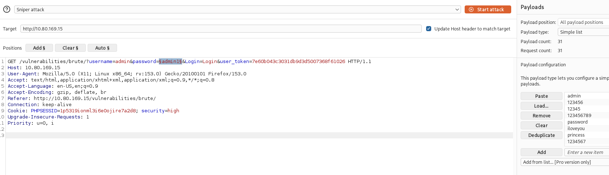
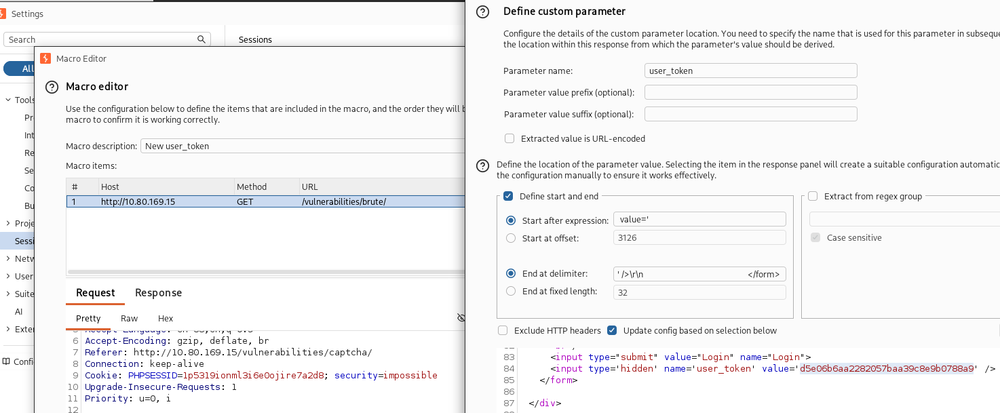
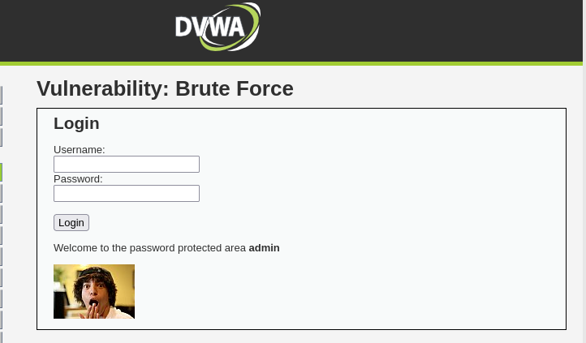

# [VULN-01] Insufficient Authentication Controls Allow Automated Credential Brute-Force

- **Severity:** High
- **CWE:** [CWE-307 – Improper Restriction of Excessive Authentication Attempts](https://cwe.mitre.org/data/definitions/307.html)
- **Affected endpoint:** `/vulnerabilities/brute/`
- **Affected security levels:** Low, Medium and High
- **Additional protection:** Implemented in Impossible
- **Affected parameters:** `username`, `password` (GET)

## Summary

The DVWA authentication endpoint does not implement effective controls to restrict repeated failed authentication attempts. Across the Low, Medium and High security levels, an attacker can automate password-guessing attempts against valid user accounts without encountering an effective request threshold or account restriction.

Although the Medium and High security levels introduce additional controls, including authentication delays and CSRF token validation, these measures do not prevent automated credential-guessing attacks. During testing, the administrative account password was successfully recovered using Burp Suite Intruder.

The Impossible security level introduces failed-login tracking and temporary account restrictions after repeated unsuccessful authentication attempts.

## Business Impact

If deployed in a production environment, insufficient authentication controls could allow an attacker to automate credential-guessing attacks against legitimate user accounts until valid credentials are recovered. Successful compromise of an administrative account could result in unauthorised access to privileged application functionality and sensitive information.

Depending on the privileges associated with the compromised account, an attacker could potentially access confidential business records, modify application data, create or manipulate user accounts, or disrupt application functionality.

Furthermore, compromised credentials may be reused against other services where users have adopted the same passwords, potentially exposing additional organisational systems and resources.

## Authentication Security Control Comparison

The authentication implementation was examined across all four DVWA security levels to evaluate the effectiveness of the security controls introduced at each level.

| Security control | Low | Medium | High | Impossible |
|---|---|---|---|---|
| HTTP method | GET | GET | GET | POST |
| Failed-login delay | None | Fixed 2 seconds | Random 0–3 seconds | Random 2–4 seconds |
| Account lockout | None | None | None | 15 minutes after 3 failed attempts |
| Anti-CSRF protection | None | None | Implemented | Implemented |
| Effective attempt restriction | None | None | None | Temporary account restriction |

The comparison demonstrates that the Medium and High security levels introduce additional friction through authentication delays and CSRF token validation. However, neither implements an effective mechanism to restrict repeated authentication attempts.

At the High security level, the rotating CSRF token can be retrieved and supplied automatically using a Burp Suite session macro, allowing automated authentication attempts to continue despite the additional token validation requirement.

The Impossible security level introduces account-level failed-login tracking and temporary restrictions, providing an additional security control against repeated credential-guessing attempts.


## Proof of Concept

**Testing environment:** DVWA Security Level – High

1. Configure DVWA to use the High security level (`security=high`).
2. Intercept a login request to `/vulnerabilities/brute/` using Burp Suite Proxy.
3. Observe that authentication credentials and the `user_token` are transmitted through a GET request.

**Example HTTP request:**

```http
GET /vulnerabilities/brute/?username=admin&password=password&user_token=<token>&Login=Login HTTP/1.1
Host: <target-ip>
Cookie: PHPSESSID=<session-id>; security=high
```

4. Configure Burp Suite Intruder to automate password-guessing attempts against the `admin` account.
5. Configure a session macro with a recursive grep rule to retrieve the updated `user_token` before each authentication attempt.
6. Execute the attack using a password dictionary.
7. Identify the valid credential pair by analysing the HTTP responses and confirming the presence of the authenticated welcome message.

**Result:** The administrative account password was successfully recovered. The application returned the following message:

```text
Welcome to the password protected area admin
```

This confirmed that the additional security controls at the High security level did not prevent the tested automated credential-guessing attack.

### Evidence

Add sanitised screenshots in the locations shown below. Ensure screenshots do not expose reusable passwords, session cookies, CSRF tokens or other sensitive values.



*Figure 1: Burp Suite Intruder configuration.*



*Figure 2: Session macro configured to retrieve the refreshed CSRF token.*



*Figure 3: Successful authentication response confirming the recovered account credentials.*


## Root Cause Analysis

The vulnerability originates from the absence of effective failed-login tracking and authentication attempt restrictions in the Low, Medium and High security implementations.

In `vulnerabilities/brute/source/high.php`, the application validates the submitted CSRF token using `checkToken()` and introduces a random delay when authentication fails. However, the implementation does not record consecutive failed authentication attempts, enforce an attempt threshold or temporarily restrict authentication attempts against the targeted account.

The following code illustrates the authentication failure handling:

```php
else {
    // Login failed
    sleep( rand( 0, 3 ) );
    echo "<pre><br />Username and/or password incorrect.</pre>";
}
```

Although the random delay increases the time required to execute individual authentication attempts, it does not prevent repeated requests or impose a restriction on the number of attempts an attacker can perform.

Additionally, CSRF token validation does not provide brute-force protection. Since an attacker can retrieve and submit updated tokens through an automated session macro, the token validation requirement does not prevent automated credential guessing.

In contrast, the Impossible implementation introduces failed-login tracking and temporary account restrictions, limiting repeated authentication attempts against an account.

## Remediation

The application should implement effective authentication throttling to restrict excessive failed login attempts. Failed authentication attempts should be tracked against individual accounts and originating IP addresses, with progressively increasing delays or temporary restrictions applied when suspicious authentication activity is detected. Account restrictions should incorporate appropriate safeguards to prevent attackers from deliberately locking out legitimate users. Additional monitoring and alerting should be implemented to identify repeated authentication failures and potentially distributed credential-guessing attacks.

Multi-factor authentication should also be considered, particularly for administrative accounts, to reduce the likelihood of account compromise even when valid credentials have been obtained.

## References

- [CWE-307: Improper Restriction of Excessive Authentication Attempts](https://cwe.mitre.org/data/definitions/307.html)
- [OWASP Web Security Testing Guide – Testing for Weak Lock Out Mechanism](https://owasp.org/www-project-web-security-testing-guide/)
- [OWASP Authentication Cheat Sheet](https://cheatsheetseries.owasp.org/cheatsheets/Authentication_Cheat_Sheet.html)
